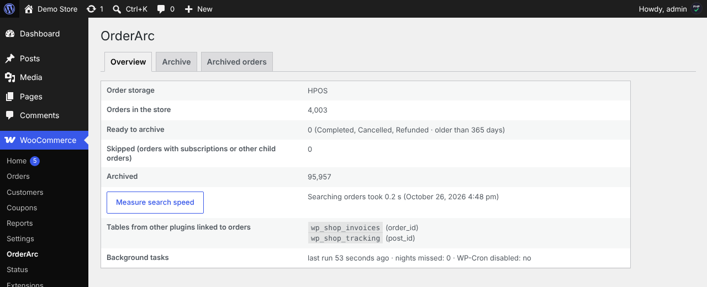
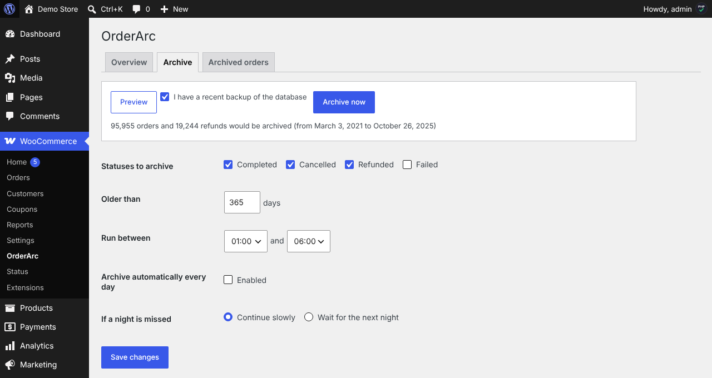
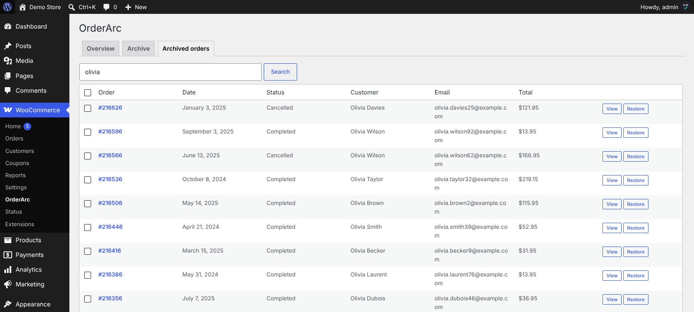
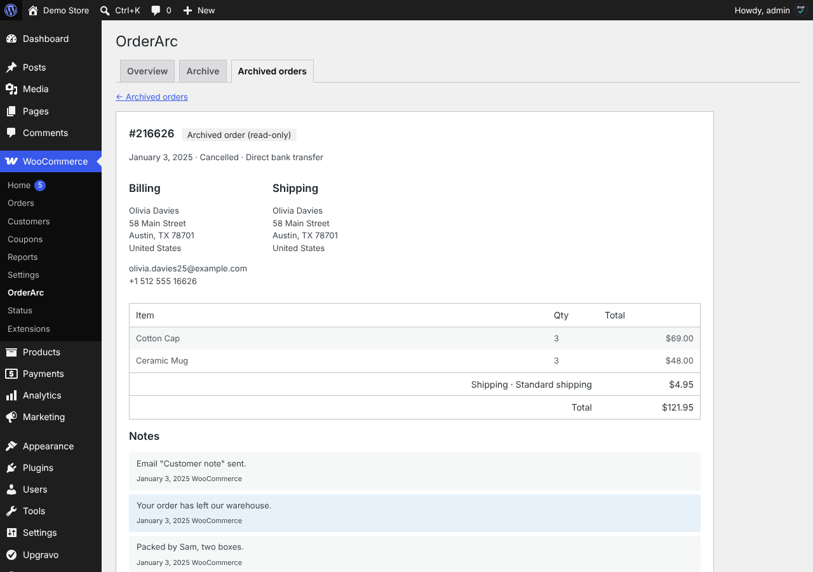
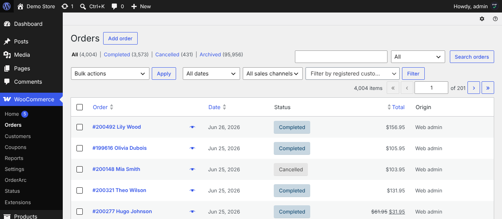
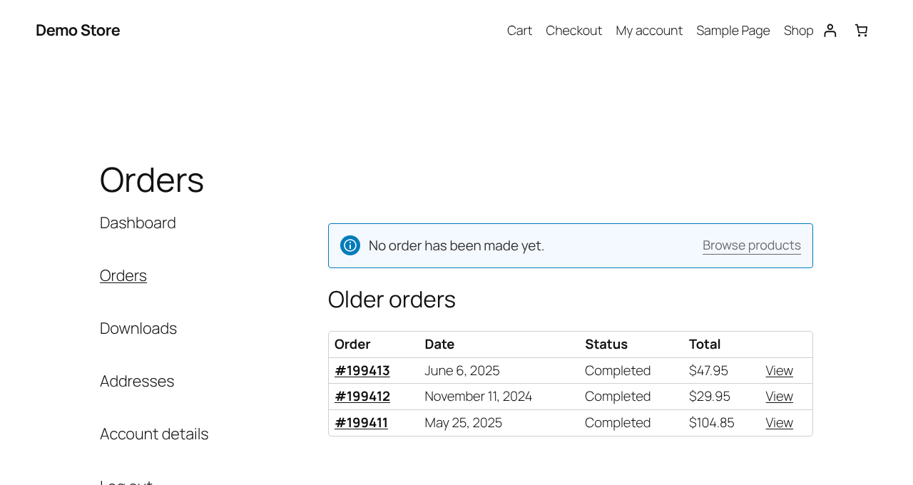

# OrderArc – Order Archive for WooCommerce

Moves old WooCommerce orders into archive tables **inside your own database**, so the orders screen and order search are fast again. Exact, verified and reversible. No external service, no account.

- **Install:** WordPress admin → Plugins → Add New → search for **OrderArc** — or [wordpress.org/plugins/orderarc](https://wordpress.org/plugins/orderarc/)
- **Website:** [getorderarc.com](https://getorderarc.com/)
- **Support:** please use the [WordPress.org support forum](https://wordpress.org/support/plugin/orderarc/) (issues are disabled here so every question is answered in one place).

## What it does

- Moves every row of an order (order, addresses, items, meta, notes, refunds, the legacy `wp_posts` copy and rows other plugins keep per order) inside one transaction, and checks row counts and checksums before deleting anything.
- Works with HPOS (with or without sync) and with legacy order storage.
- Search, open and restore archived orders with one click; customers still see their own archived orders in My Account.
- WooCommerce Analytics keeps counting archived orders.

## Screenshots

| | |
|---|---|
|  |  |
|  |  |
|  |  |

## License

GPLv2 or later.
